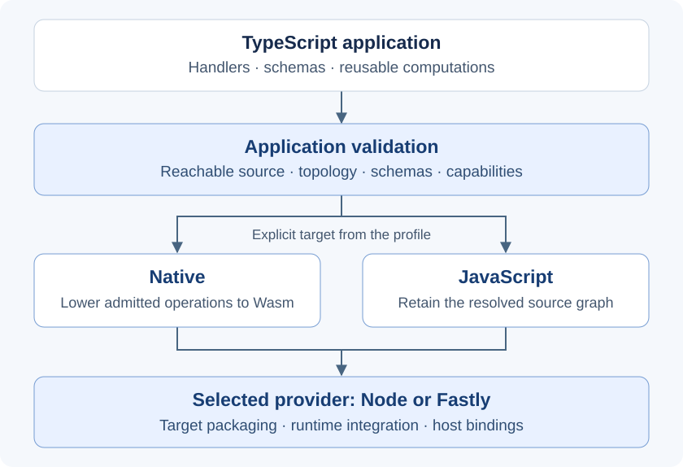

# Architecture overview

Pulse turns a TypeScript application into an explicit execution artifact. You
write handlers, schemas and reusable computations; a project profile selects
**Native or JavaScript** and a **provider such as Node or Fastly**. The compiler
checks the application's requirements, and the provider connects it to the host.

Four parts explain the architecture:

| Part | Responsibility |
| --- | --- |
| Application | Defines routes or events, structured data, computations and requested capabilities. |
| Compiler | Resolves reachable source, validates the application and prepares the selected target. |
| Runtime | Owns each invocation's values, effects, continuations, deadlines and cleanup. |
| Provider | Supplies host bindings, target packaging and execution. |

## From source to a runnable artifact

A profile fixes the target and provider before the build. Both paths check
static application topology, schemas and recognized Pulse capabilities.
**Native** then requires proof that the reachable source can be lowered to
canonical operations and Wasm. **JavaScript** retains the original resolved
source graph, including ordinary target-compatible dependency calls.

Unsupported Native source produces an error. Running it as JavaScript requires
an explicit profile change. JavaScript inspection describes recognized Pulse
behavior; it does not analyze arbitrary dependency internals or sandbox them.
See [Compilation and lowering](../concepts/compilation-and-lowering.md) for the
compiler phases and [Targets and host work](../concepts/targets-and-hosts.md)
for target selection.

## The application contract

`@pulse-compute/pulse` supplies the conventional `Pulse` application root,
configuration helpers and schema declarations. `@pulse-compute/runtime` owns
handler/context types and the static `Router` contract. Plain handlers, Router
and Pulse applications enter the same compiler and execution model.

A handler receives `ctx`, which exposes the operations admitted for its context
and selected provider. Managed host work—such as fetch, secrets and KV—passes
through explicit capabilities and bindings. Schemas define bounded structured
input and output. Provider SDK objects stay outside the portable handler API.

HTTP handlers select routes and produce responses. Event handlers select an
exact event type, receive a schema-validated payload and complete with `void`.
The provider owns ingress; an outbound `ctx.emit` frame has no automatic local
loopback or delivery receipt. See [Routing](../guides/routing.md),
[Events](../guides/events.md) and the [canonical API](../../API.md).

## One invocation owns the work

Each HTTP request or direct event invocation owns its state and pending work.
A managed effect asks the host to perform an operation. In Native, the program
suspends at an explicit continuation and resumes with the host's result.
JavaScript uses the execution-owned runtime and effect adapter. Application
code uses the same managed API without creating continuation objects itself.

Use `ctx.parallel` to express independent concurrent work. Completion, failure,
expiry and cancellation terminate the invocation's authority: late results
cannot restart it. Cancellation does not undo a remote write already dispatched.
[Effects and continuations](../concepts/effects-and-continuations.md) explains
concurrency, budgets and failure handling.

### Shared computation through `ctx.call`

An admitted HTTP or managed MCP operation can call a statically imported
computation with registered input and output schemas. The call stays inside the
current invocation and shares its budget. Its callee receives readonly input,
resource reads and numeric workspaces; it receives no network, secret, KV or
response authority. The returned result is validated and independently owned.

This lets a route and an MCP tool reuse computation without another HTTP request
or a separate execution engine. Calls are synchronous and bounded: no dynamic
targets, nested or recursive calls, or calls in loops. Node Native, Fastly Native
and Node JavaScript support this boundary; Fastly JavaScript and event contexts
do not. See [`ctx.call`](../../API.md#ctxcall) for the exact authoring contract.

### Data has explicit ownership

Structured bodies become bounded invocation-owned values. Opaque network bodies
and streams remain host-owned. Embedded binary resources provide immutable
build-selected data, while numeric workspaces provide temporary computation
storage. None of these surfaces grants ambient filesystem or network access.
See [Bodies](../concepts/bodies.md),
[`ctx.resources`](../../API.md#ctxresources) and
[`ctx.workspace`](../../API.md#ctxworkspace).

## Packages contribute behavior; providers realize it

Domain packages own their APIs and the mapping to supported operations. A
trusted package lowerer contributes that mapping at build time; shared contracts
own operation semantics, and the compiler coordinates validation and lowering.
For example, Entities owns operation selection and schema-bound invocation,
while MCP owns protocol admission and tool framing. Their computations use the
same runtime machinery as other admitted handlers.

Ordinary imports grant no compiler-plugin authority. Declared lowerers execute
as trusted build dependencies with the compiler process's authority. Admission
checks their versioned contract and package ownership. See
[Package-owned lowering](../concepts/package-owned-lowering.md) and
[Entities and adapters](../concepts/entities-and-adapters.md).

The selected provider supplies host operations, deployment bindings, packaging
and local execution through its versioned `./toolchain` contract. A supported
provider/target combination can still reject a project whose capabilities or
bindings it cannot satisfy. The compile-only `none` selector emits Native
artifacts without executing them. The
[compatibility matrix](../reference/compatibility-matrix.md) owns exact target
support; [Contracts and providers](../concepts/contracts-and-providers.md)
explains binding and eligibility.

## Inspect the boundary you are about to ship

`pulse doctor` checks project readiness, `pulse inspect` explains recognized
structure and eligibility, and `pulse build` produces the selected provider
artifact. `pulse report` describes retained build evidence, including artifact
size, resource attribution and explicitly unavailable measurements. A local
build and a deployed-service test establish different evidence.

Use [Project lifecycle](../guides/project-lifecycle.md) for the command workflow.
The [Architecture contracts](./current-contracts.md) hold implementation-level
invariants. [Vision](./vision.md) and [plugin readiness](../maintainers/plugin-readiness.md)
describe future direction and deferred extension work. Repository-change
procedures live in [Maintainer governance](../maintainers/README.md).
