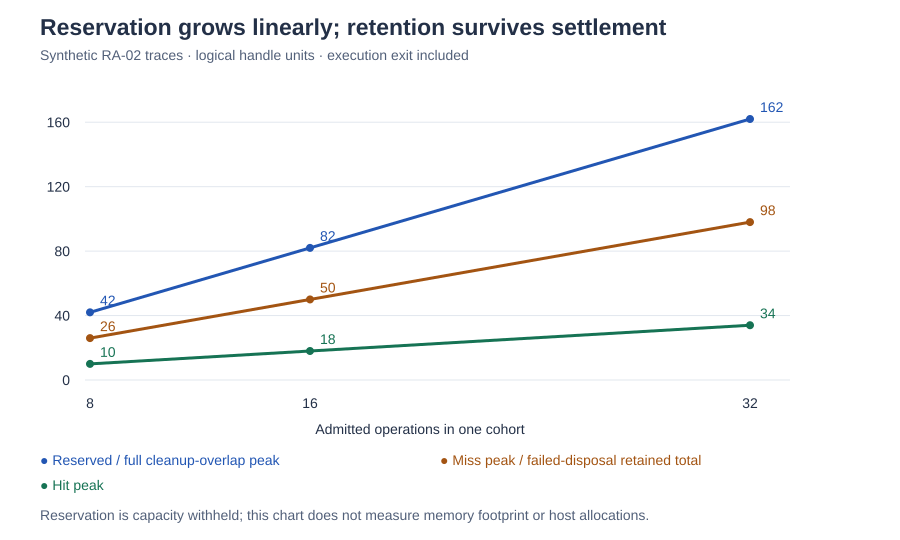

# RA-02 follow-up: reservation pressure at 8, 16 and 32

Status: **completed offline evidence; no production service change**.
Human direction: perform a bounded reservation sweep before RA-03. Base:
`65da931d399e0dfac53ace9938edf3330e764b9c` (`hex-integration`, #528).
No exact named Entry Point covers this internal experiment; ordinary root/docs
instructions apply. Change class: evidence; scope: evidence-only; protected
boundaries: none. RA-03 remains a separately authorized unit.

The unchanged [RA-02 oracle](../model.cjs) passes **33 cases**: six lifecycle
traces, an exact cumulative-effect boundary, and four one-unit-short boundaries
at each of 8, 16 and 32 roots. Every accepted event checks charges <= committed
reservation <= capacity in all three dimensions. Rejected events preserve the
ledger; the driver then explicitly denies those captured roots.

## Findings

Reservation remains additive and linear at all tested widths. Protected cleanup
can consume its entire allowance while work resources remain charged, without
borrowing another root's envelope or the execution exit reserve. Successful
cleanup returns the ledger to the execution reserve. Unknown disposal retains
both its charge and cleanup headroom after effect settlement and execution end;
there is no synthetic release receipt or retry.

This supports carrying the conservative policy into RA-03. It does **not** prove
the implementation is inexpensive: the oracle uses cloned JavaScript state and
retained history. No ledger memory layout, allocation cost, CPU time, Wasm size,
real host consumption, throughput or optimal concurrency was measured.



All numbers below are synthetic logical units. The chosen fixture declares work
`(3 handles, 192 bytes, 4 records)`, cleanup `(2 handles, 64 bytes, 2 records)`
per root, and execution exit `(2 handles, 64 bytes, 2 records)`. Baseline is zero.
Totals include execution exit. These byte charges are **not** bookkeeping-record
sizes or total runtime memory, and handle units are **not** a Fastly quota.

| Width | Reserved handles | Reserved bytes | Reserved records | Root + possible child admissions |
| --- | ---: | ---: | ---: | ---: |
| 8 | 42 | 2,112 | 50 | 32 |
| 16 | 82 | 4,160 | 98 | 64 |
| 32 | 162 | 8,256 | 194 | 128 |

Use 8 and 16 as the selected ordinary-pressure cases and 32 as the selected
boundary case. This is a human-selected qualification range, not a workload
frequency claim. The existing collection `max` range is 1–32; it bounds one
collection's membership, not execution-wide retained resources. The model admits
fresh cohorts directly; it does not execute a DSL builder or keyed parallel hook.

### Reserved versus peak charged capacity

Each cell is `(handles, bytes, records)`. Peaks are computed from every event,
not from sampling the named checkpoints. These traces deliberately overlap all
roots and the execution exit charge; they are pressure constructions, not
observed host schedules. Each vector below is reached in its trace, although
the collector generally records independent per-dimension maxima.

| Trace | Width 8 peak | Width 16 peak | Width 32 peak |
| --- | --- | --- | --- |
| Hit | (10, 576, 10) | (18, 1,088, 18) | (34, 2,112, 34) |
| Miss / full work | (26, 1,600, 34) | (50, 3,136, 66) | (98, 6,208, 130) |
| Cancellation + full cleanup overlap | (42, 2,112, 50) | (82, 4,160, 98) | (162, 8,256, 194) |
| Failed disposal + full cleanup overlap | (42, 2,112, 50) | (82, 4,160, 98) | (162, 8,256, 194) |
| Retained result + late cleanup | (26, 1,088, 26) | (50, 2,112, 50) | (98, 4,160, 98) |
| Mixed success/unknown disposal | (42, 2,112, 50) | (82, 4,160, 98) | (162, 8,256, 194) |

In the all-miss trace the unspent reservation is exactly the protected cleanup
allowance: `(16, 512, 16)`, `(32, 1,024, 32)` and `(64, 2,048, 64)` at the three
widths. The hit trace additionally leaves miss-path work capacity unused. At
width 32, the gap between reservation and peak hit charge is `(128, 6,144, 160)`.
This is withheld capacity, not an allocation overhead measurement.

The hit and miss traces never acquire cleanup-lane resources; their entire
cleanup allowance remains unused. The other four traces reach the full declared
cleanup-lane allowance, so their minimum unused allowance is zero. The receipt
records both the peak cleanup-lane charge and minimum unused allowance. This
lane-based statistic does not imply all cleanup used *additional* capacity above
the work envelope: late cleanup can occupy unused work space, as RA-02 permits.

### Retention after settlement

At width 32, an unresolved or retained result costs one handle, 64 bytes and one
record per affected root. It also keeps two handles, 64 bytes and two records of
cleanup headroom. That headroom is still withheld even when an unresolved result
has no safe cleanup action left under v0.

| Trace | Committed after settlement, width 8 | Width 16 | Width 32 | After late cleanup / end |
| --- | --- | --- | --- | --- |
| Hit, miss, successful cancellation cleanup | (2, 64, 2) | (2, 64, 2) | (2, 64, 2) | Execution reserve only |
| Every root has unknown disposal | (26, 1,088, 26) | (50, 2,112, 50) | (98, 4,160, 98) | Unchanged at end; no refund |
| Every root has a retained result | (26, 1,088, 26) | (50, 2,112, 50) | (98, 4,160, 98) | Proven late cleanup leaves (2, 64, 2) |
| Half succeed, half have unknown disposal | (14, 576, 14) | (26, 1,088, 26) | (50, 2,112, 50) | Unchanged at end; no refund |

At exact first-cohort capacity, all three retention scenarios reject a second
same-width cohort atomically. Successful late cleanup then permits a **new**
explicit cohort; the rejected cohort stays invalid. Captured effect admissions
remain spent throughout. This is the material pressure beyond the linear width
curve: zero active roots does not imply an empty resource ledger.

## Trace assumptions and limits

- Hit: one child admission and one `(1, 64, 1)` work claim per root, then proven
  release. Miss: three child admissions and work claims `(1, 64, 1)`,
  `(1, 64, 1)`, `(1, 64, 2)`, then proven release.
- Cancellation: after children settle, stop business work while all work claims
  remain. Verify further work acquisition rejects; acquire full cleanup for all
  roots before releasing anything. This is resource cleanup pressure, not a new
  in-flight cancellation or host race qualification.
- Failed disposal: same full overlap, cleanup auxiliaries release, but one work
  claim per root has unknown disposition/access. Other claims release; optimistic
  refunds reject. No retry or reconciliation follows.
- Retained result: one work claim per root survives settlement. Late cleanup
  consumes all retained cleanup headroom before qualified release of both claims.
- Mixed: full-work roots, full cleanup overlap, even-numbered roots retain one
  unknown claim and odd-numbered roots release everything. No partial result
  delivery or rollback semantics are implied.
- Ownership rows and refund proofs are explicitly synthetic fixture inputs to
  RA-02. This sweep does not rerun RA-01 ownership transitions or establish real
  ABI dispositions. No exclusivity or body-size variability is added here.
- Every trace uses the same declared work/cleanup profile and effect budget of
  1,024. Separate boundary cases admit and spend exactly `4 * width` effects;
  one fewer rejects. One fewer handle, byte or record also rejects atomically.
  No numeric production defaults are chosen.

## Reproduction and evidence

From the repository root:

```sh
node docs/internal/host-extensions/resource-accounting/ra02/sweep/check.cjs /tmp/hex-ra02-sweep.json
node docs/internal/host-extensions/resource-accounting/ra02/sweep/report.cjs /tmp/hex-ra02-sweep.json /tmp/hex-ra02-sweep-report
```

[receipt.json](receipt.json) contains source hashes, per-event peaks, named
checkpoints, event counts, trace hashes and the compressed trace digest.
[traces.json.gz](traces.json.gz) preserves the full event/after-state counters.
The renderer verifies oracle/harness input hashes before generating the report
and [pressure.svg](pressure.svg). Source revision plus working-tree state and
input hashes identify the executed bytes; a base revision alone is insufficient.
[validation.json](validation.json) records completed local checks and attempt
history. This evidence supplements the original RA-02 receipt; it does not
replace or rewrite it.

The [recovery evidence index](evidence-index.json) pins exact oracle/harness
inputs, the initial passing 30-case selection, the 72-case RA-02 regression
receipt, and a fresh reproduction of all 33 final cases. Recovery reproduced
the original traces and plot exactly. The original documentation check failed
at the published-context missing-report probe; an unchanged retry passed.
The release simulation also failed at the false/ready probe, then passed with
a logging-only subprocess observer and unchanged deadlines. Both failures and
the observer source remain in the validation archive; their cause is unconfirmed.

RA-03 should reuse these widths and lifecycle cases while measuring actual record
storage, allocation behavior and execution cost. It should also measure the
unused path and retain the existing obligations for admission hooks, finite
control bounds and containment. There is no policy change justified by this
sweep, and no scheduler or reservation optimizer is introduced.
